<div align="center">

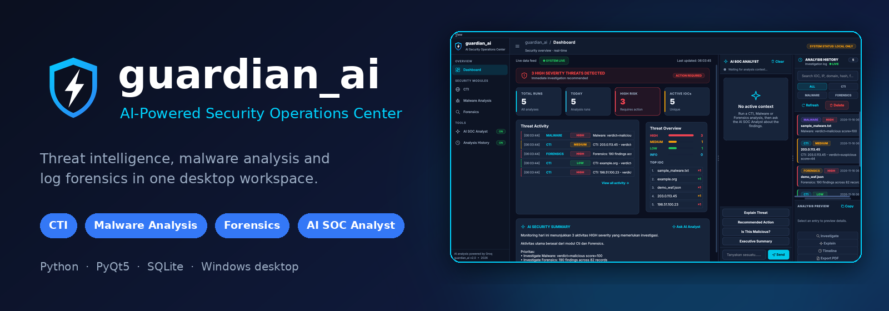

# guardian_ai

**AI-Powered Security Operations Center**

A desktop investigation workspace that brings threat intelligence, malware analysis and log forensics together in one place.

[](docs/INSTALLATION.md)
[](https://pypi.org/project/PyQt5/)
[](docs/INSTALLATION.md)
[](https://github.com/USERNAME/guardian-ai-soc-platform/actions/workflows/tests.yml)
[](#project-limitations)

[**Download for Windows**](https://github.com/USERNAME/guardian-ai-soc-platform/releases/latest) ·
[Installation](docs/INSTALLATION.md) ·
[Configuration](docs/CONFIGURATION.md) ·
[Architecture](docs/ARCHITECTURE.md) ·
[Features](docs/FEATURES.md)

</div>

> **Heads-up for first-time readers:** every screenshot in this repository uses **synthetic demonstration data**
> (RFC 5737 documentation IP addresses and `.example` domains). Nothing here comes from a real network, customer or incident.

---

## Highlights

| | |
|---|---|
| **One workspace, three disciplines** | IOC enrichment (CTI), malware inspection and WAF/NGFW/PCAP forensics without switching tools. |
| **Honest by design** | The UI always says where a verdict came from (`LOCAL ANALYSIS`, `HYBRID ANALYSIS ENRICHMENT`, `CORRELATED ANALYSIS`) and never reports a sandbox run that did not happen. |
| **Works offline** | Every API key is optional. Without keys the application still opens and the local/offline features keep working. |
| **AI-assisted, evidence-first** | A context-aware AI SOC Analyst (Groq) explains findings; answers are grounded in the analysis result that is currently open. |
| **Investigation trail** | Every analysis is saved to a local SQLite history, summarised on a dashboard and exportable as a PDF incident report. |
| **Tested** | Headless, hermetic regression suite (no network, no real keys) covering analysis engines, UI pages, history, PDF export and layout. |

## Screenshots

<table>
  <tr>
    <td width="50%"><a href="docs/screenshots/01-dashboard.png">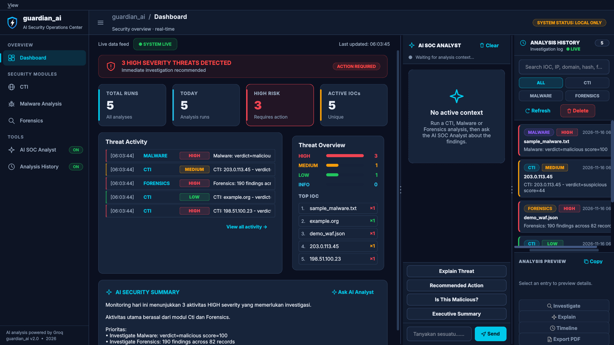</a><br><sub><b>Dashboard</b> - security status, live statistics, top IOCs</sub></td>
    <td width="50%"><a href="docs/screenshots/02-cti-overview.png">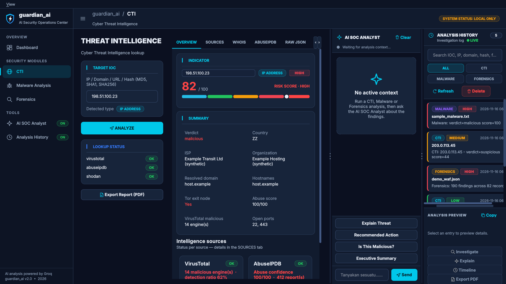</a><br><sub><b>CTI overview</b> - risk meter and per-source status</sub></td>
  </tr>
  <tr>
    <td><a href="docs/screenshots/03-abuseipdb.png">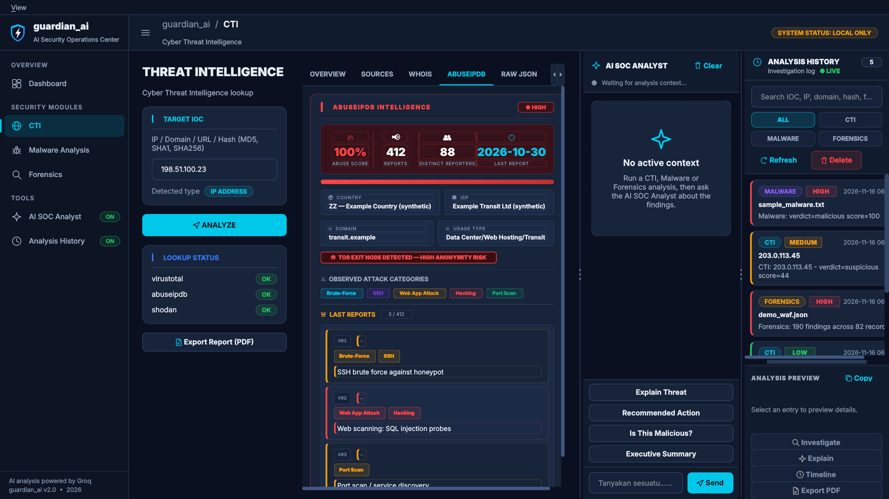</a><br><sub><b>AbuseIPDB intelligence</b> - confidence score and recent reports</sub></td>
    <td><a href="docs/screenshots/04-malware-analysis.png">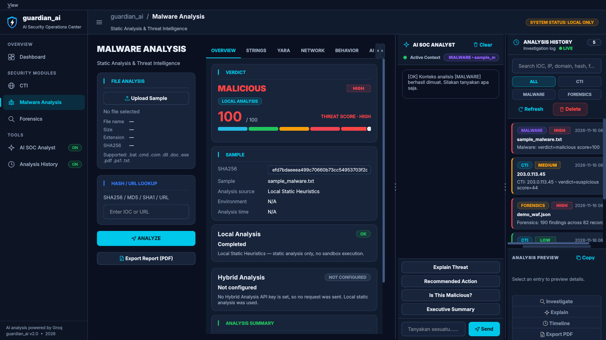</a><br><sub><b>Malware analysis</b> - verdict, risk meter, honest source status</sub></td>
  </tr>
  <tr>
    <td><a href="docs/screenshots/05-forensics-findings.png">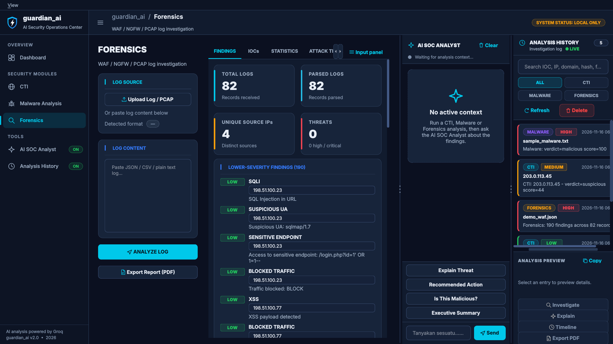</a><br><sub><b>Forensics findings</b> - WAF log investigation</sub></td>
    <td><a href="docs/screenshots/06-attack-timeline.png">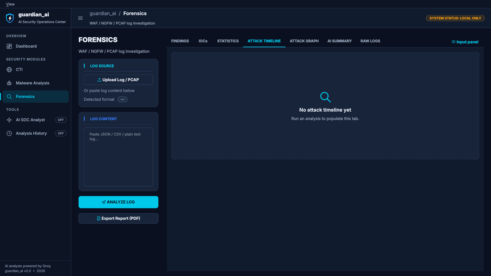</a><br><sub><b>Attack timeline</b></sub></td>
  </tr>
  <tr>
    <td><a href="docs/screenshots/07-attack-graph.png">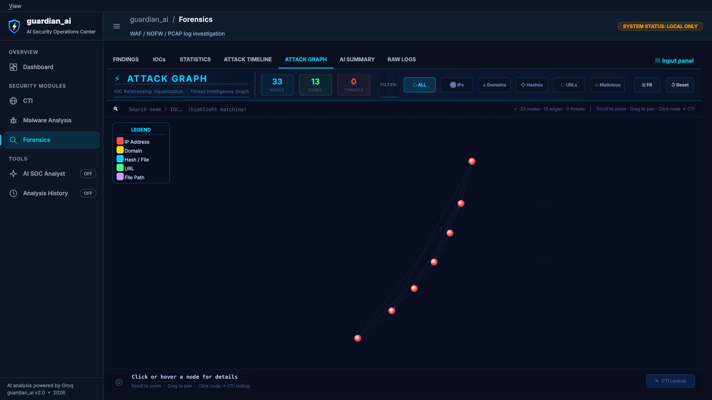</a><br><sub><b>Attack graph</b> - IOC relationship visualisation</sub></td>
    <td><a href="docs/screenshots/08-ai-soc-analyst.png">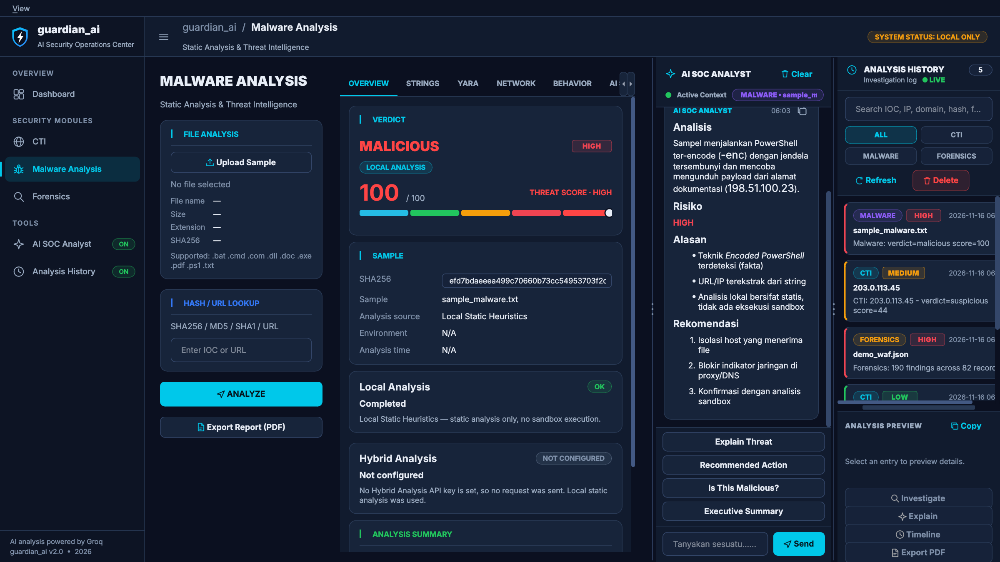</a><br><sub><b>AI SOC Analyst</b> - context-aware chat (the answer shown is illustrative)</sub></td>
  </tr>
  <tr>
    <td colspan="2" align="center"><a href="docs/screenshots/09-analysis-history.png">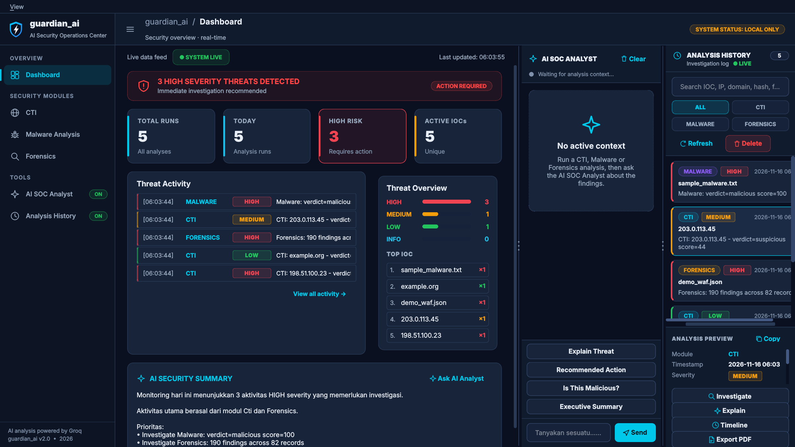</a><br><sub><b>Analysis history</b> - searchable investigation log</sub></td>
  </tr>
</table>

## Project overview

**guardian_ai** is a desktop-based, AI-assisted SOC investigation platform. It lets a security analyst take an indicator, a
file or a log, and move from raw data to an evidence-backed conclusion inside a single application:

- **Cyber Threat Intelligence** - enrich IPs, domains, URLs and file hashes.
- **Malware Analysis** - inspect files and hashes with local static analysis and optional sandbox-report enrichment.
- **Network and Log Forensics** - analyse WAF / NGFW logs and Wireshark captures, extract IOCs, build an attack timeline and graph.
- **AI-assisted investigation** - ask questions about the result that is on screen and get structured, risk-rated answers.

The goal is to reduce the time an analyst spends hopping between separate tools for IOC enrichment, malware inspection,
log investigation and threat correlation.

## Key features

### 1. Cyber Threat Intelligence
- VirusTotal, AbuseIPDB and Shodan lookups (Shodan only when a key is configured), plus WHOIS enrichment for domains.
- Automatic IOC type detection (IP, domain, URL, MD5 / SHA1 / SHA256) and IOC classification.
- Per-source status cards with clear states: `OK`, `NO DATA`, `ERROR`, `NOT CONFIGURED` - real errors such as rate limits are shown, not hidden.
- Risk meter, summary grid, AbuseIPDB report list and raw JSON view.

### 2. Malware Analysis
- **Local static analysis** (no external service needed): string extraction, suspicious-pattern detection, Base64 and PowerShell `-EncodedCommand` inspection, network-indicator extraction (URLs, IPs, domains), EICAR test-signature recognition and a YARA-style pattern scan.
- **Hybrid Analysis enrichment** for hashes, files and URLs when `HYBRID_API_KEY` is set.
- **Local fallback mode** when the external service is unavailable - clearly labelled, never presented as a sandbox result.
- Threat score, severity, behavioural findings and MITRE ATT&CK mapping where the analysis provides them.

### 3. Forensics
- WAF and NGFW log analysis (JSON, CSV and plain-text logs) with a rule-based detection engine.
- Wireshark **PCAP / PCAPNG** analysis through PyShark (requires TShark - see [Installation](docs/INSTALLATION.md#optional-tshark-for-pcap-analysis)).
- IOC extraction, findings, traffic statistics, **Attack Timeline** and interactive **Attack Graph**.
- Paginated raw-log view that stays responsive on large inputs.

### 4. AI SOC Analyst
- Groq-powered chat with automatic context from the CTI, Malware or Forensics result that is open.
- Quick actions: explain the threat, recommended action, "is this malicious?", executive summary.
- Rule-based fallback summaries when no AI key is configured.

### 5. Investigation management
- SQLite analysis history with module filters, search, preview and one-click *Investigate / Explain / Timeline / Export PDF*.
- Dashboard statistics (runs, high-risk findings, top IOCs, recent activity).
- PDF incident reports.

> Only features present in this repository and covered by its tests or documented limitations are listed.
> See [docs/FEATURES.md](docs/FEATURES.md) for details and verification notes.

## Architecture overview

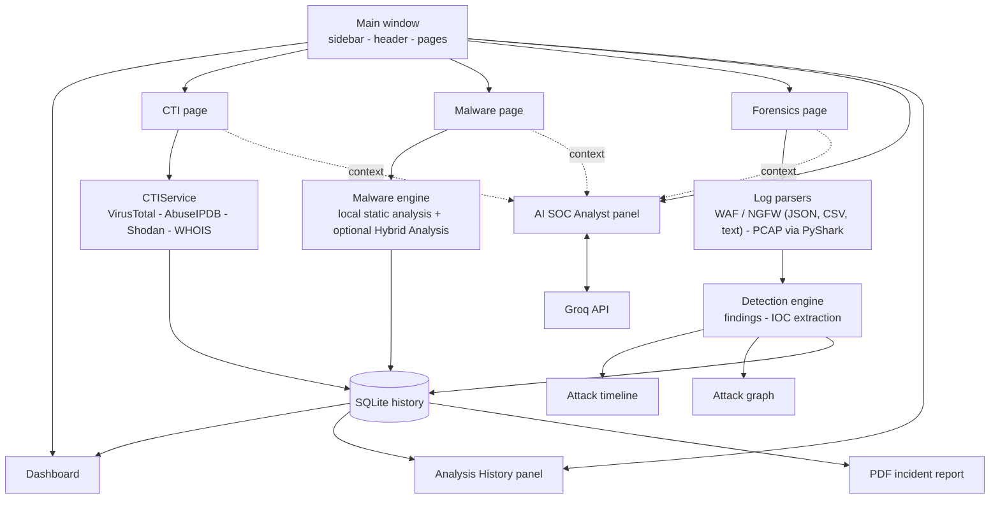

The application is currently a single large Python module (`guardian_ai_v4_fixed.py`) plus a small `ui/` package for the design
system and reusable widgets. See [docs/ARCHITECTURE.md](docs/ARCHITECTURE.md) for the real structure.

## Installation

Full, beginner-friendly guide: **[docs/INSTALLATION.md](docs/INSTALLATION.md)**.

```powershell
git clone https://github.com/USERNAME/guardian-ai-soc-platform.git
cd guardian-ai-soc-platform

py -3.12 -m venv .venv
.\.venv\Scripts\Activate.ps1

python -m pip install --upgrade pip
pip install -r requirements.txt
pip install -r requirements-optional.txt     # optional: PCAP support, faster graph layout

Copy-Item .env.example .env                  # then add your own API keys (all optional)
python guardian_ai_v4_fixed.py
```

Prefer not to install Python? Download `guardian_ai.exe` from the [Releases page](https://github.com/USERNAME/guardian-ai-soc-platform/releases/latest)
(the executable is **not code-signed**; Windows SmartScreen may show a warning on first launch).

## API configuration

All keys are optional. A missing key only disables the matching feature.

| Variable | Used for | Where to get it |
|---|---|---|
| `VIRUSTOTAL_API_KEY` | VirusTotal reputation | <https://www.virustotal.com> -> profile -> *API key* |
| `ABUSEIPDB_API_KEY` | AbuseIPDB reputation + reports | <https://www.abuseipdb.com> -> *Account* -> *API* |
| `SHODAN_API_KEY` | Shodan host lookup | <https://account.shodan.io> |
| `HYBRID_API_KEY` | Hybrid Analysis reports | <https://www.hybrid-analysis.com> -> *Profile* -> *API key* |
| `GROQ_API_KEY` | AI SOC Analyst and AI summaries | <https://console.groq.com/keys> |
| `GROQ_MODEL` | Optional model override | - |

Keys live in a local `.env` file that is git-ignored. Details: **[docs/CONFIGURATION.md](docs/CONFIGURATION.md)**.
Free/trial plans have provider-side limits; availability depends on your own account.

## Usage guide

**CTI**
1. Enter an IOC (IP, domain, URL or hash) - the detected type is shown under the input.
2. Click **ANALYZE**.
3. Review the *Overview* tab (risk meter and summary).
4. Open **SOURCES**, **WHOIS** and **ABUSEIPDB** to inspect each source report.
5. Check the **AI SUMMARY** tab, or ask the AI SOC Analyst.

**Malware**
1. Upload a sample (or type a SHA256 / MD5 / SHA1 / URL).
2. Click **ANALYZE**.
3. Review the verdict, risk meter and the *Local Analysis* card under **OVERVIEW**.
4. Check the *Hybrid Analysis* card for external sandbox-report status (only available with a key).
5. Inspect **STRINGS**, **YARA**, **NETWORK** and **BEHAVIOR**.
6. Read the **AI SUMMARY**.

**Forensics**
1. Upload a WAF / NGFW log or a PCAP (or paste log text) and click **ANALYZE LOG**.
2. Review **FINDINGS**.
3. Inspect **IOCs**.
4. Review the **ATTACK TIMELINE**.
5. Open the **ATTACK GRAPH** (the input panel folds away to give it room).
6. Export an incident report with **Export Report (PDF)**.

## Technical stack

Python 3.12 - PyQt5 - SQLite (`sqlite3`) - Requests - python-dotenv - python-whois - ReportLab - PyShark (optional) - NumPy (optional) -
PyInstaller (Windows build) - pytest / pytest-qt - GitHub Actions.
External services: VirusTotal, AbuseIPDB, Shodan, Hybrid Analysis, Groq (all optional, user-supplied keys).

## Testing

```powershell
pip install -r requirements-dev.txt
python -m pytest
```

The suite runs headless (`QT_QPA_PLATFORM=offscreen`) and is **hermetic**: `tests/conftest.py` blocks outbound HTTP, ignores any
real API keys and redirects Qt settings to a temporary folder. The PCAP test is skipped automatically when TShark is not installed.
Fixtures in `tests/fixtures/` are inert and synthetic.

## Why I built guardian_ai

Security analysts routinely lose time to fragmented tooling:

- IOC enrichment is manual - copy an indicator into several websites and compare the answers.
- Malware triage often depends on an external sandbox that may be unavailable or rate-limited.
- Reading WAF / NGFW / PCAP logs line by line is slow and easy to get wrong.
- Findings end up scattered across tabs, notes and chat messages with no single investigation trail.

guardian_ai explores what a single, consolidated workspace could look like, with AI used to *explain* evidence rather than replace it.

## Technical challenges

<!-- TODO(owner): replace/extend with your own first-hand experience before publishing. -->
- Integrating several threat-intelligence APIs with different schemas, rate limits and failure modes into one consistent result model.
- Building a **local malware-analysis fallback** that is useful offline but never overstated as a sandbox result.
- Handling different WAF / NGFW log formats and very large inputs without freezing the UI.
- Processing PCAP files through an optional system dependency (TShark).
- Producing an **Attack Timeline** and **Attack Graph** from detections, including a stable graph layout.
- Managing the **QThread lifecycle** (cancellation, stale results, clean shutdown).
- Keeping AI answers **context-isolated** to the analysis that is currently open.

## What I learned

<!-- TODO(owner): keep only what is true for you. -->
Python and PyQt5 desktop development - SOC investigation workflow - CTI enrichment - malware static analysis - network forensics -
thread safety in GUI applications - SQLite - third-party API integration - regression testing and CI.

## My contributions

> **TODO(owner) - fill this in with facts only.** guardian_ai began as a **team project**; this section must describe *your* part and
> credit the others. Do not claim work you did not do.

| | |
|---|---|
| **Name / handle** | `<your name>` |
| **Role in the team** | `<e.g. developer - CTI / malware / forensics>` |
| **Period** | `<start - end>` |
| **Team** | `<number of people, other contributors / links>` |
| **Original context** | `<event / programme the project started in, and the publication permission that was obtained>` |

My personal contributions (examples to confirm or delete):
- [ ] `<CTI module: ...>`
- [ ] `<Malware analysis module: ...>`
- [ ] `<Forensics module: ...>`
- [ ] `<Integration / detection logic: ...>`
- [ ] `<UI/UX redesign, design system, test suite, CI, packaging: ...>`

Contributions by other team members: `<names and areas>`.

## Project limitations

- Several features need **your own API keys**; availability and quotas depend on the provider and your plan.
- **PCAP analysis needs TShark** (Wireshark), a system dependency, not just a pip package.
- Local malware analysis is **static heuristic / signature-style analysis**, not a sandbox and not a replacement for one. The "YARA" tab is a pattern scan inspired by YARA rules, not the YARA engine.
- Every verdict must be **validated against evidence**; AI output can be wrong.
- Groq and the external threat-intelligence APIs need an internet connection.
- guardian_ai is **not an antivirus and not a production-grade EDR**.
- The Windows executable is not code-signed; the Windows build and the executable are documented in [docs/RELEASE.md](docs/RELEASE.md).
- The automated test-suite was verified on Linux / Python 3.12; see [CHANGELOG.md](CHANGELOG.md) for verification notes.

## Disclaimer

guardian_ai is a **security research, learning and portfolio demonstration project**. Use it only to analyse systems, files and logs
that you are **authorised** to examine. The files in `tests/fixtures/` are **inert test fixtures** - they must never be executed.
See [SECURITY.md](SECURITY.md) for safe-handling guidance.
